  

# 🧪 Awesome Test Environment Diagnostics & Telemetry 📊 🚀

  
  
  
  
  

> 🌟 A curated architectural directory and guide to top **Test Environment Diagnostics**, **Continuous Testing Telemetry**, **Synthetic Monitoring**, and **Test Observability** platforms — featuring enterprise SaaS monitoring solutions, distributed trace correlation engines, and open-source TestOps backends for diagnosing test suite execution, isolating flaky tests, monitoring test runners, and accelerating CI/CD pipelines.  
> 
> ⭐ *Star this repository if you find it helpful!* ⭐

---

## 📋 Table of Contents 📑

- [🌐 Sector Overview & Market Dynamics](#-sector-overview--market-dynamics)
- [☁️ SaaS & Hosted Commercial Platforms](#️-saas--hosted-commercial-platforms)
- [💻 Open-Source Software & Test Diagnostics Engines](#-open-source-software--test-diagnostics-engines)
- [📊 Feature Comparison Matrix](#-feature-comparison-matrix)
- [🎯 Key Diagnostics & Observability Capabilities](#-key-diagnostics--observability-capabilities)
- [💖 Support & Community](#-support--community)
- [📈 Star History](#-star-history)
- [🤝 Contributing](#-contributing)
- [📄 License](#-license)

---

## 🌐 Sector Overview & Market Dynamics 📈

The global **test environment management, synthetic monitoring, and application observability market** is valued at approximately **$24 Billion to $32 Billion**, projected to expand at an estimated **14% to 18% CAGR** toward **$70B+ by the early 2030s** as distributed microservices, ephemeral CI/CD runners, and complex browser automation demand continuous telemetry.

The sector exhibits **moderate fragmentation**: comprehensive infrastructure and APM giants (such as Cisco ThousandEyes, Datadog, Dynatrace, and New Relic) dominate enterprise-wide trace correlation and synthetic uptime monitoring, while specialized test execution infrastructure platforms (such as BrowserStack) and niche pre-production digital experience suites (Catchpoint, SpeedCurve, Sentry) capture dedicated test workflow budgets, complemented by an active open-source ecosystem centered on OpenTelemetry, Jaeger, SigNoz, and OpenObserve for privacy-first, self-hosted environments.

---

## ☁️ SaaS & Hosted Commercial Platforms 🏢

Commercial cloud-hosted test analytics, environment diagnostics, and synthetic monitoring platforms. The table below is sorted in descending order of vendor scale (company valuation / enterprise revenue).

| 🏢 Platform | 💰 Scale (Valuation / Revenue) | 🏷️ Starting Tier Price | 🎁 Free Tier Limit / Free Trial | 🔍 Key Capabilities | 🎯 Best For |
|---|---|---|---|---|---|
| **[Cisco ThousandEyes](https://www.thousandeyes.com/)** | **~$200B+ Cisco Market Cap** (~$55B ARR; acquired for ~$1B) | **~$1,200 / year** (Cloud & Enterprise Agent unit capacity pack) | **15-Day Free Trial** (includes full access to Enterprise & Cloud Agents with 100 test runs) | Network path BGP/DNS hop-by-hop diagnostics, internet outage correlation, Endpoint Agent telemetry | Diagnosing network transit, ISP latency, and routing failures across multi-region test environments |
| **[Datadog Synthetic Monitoring & APM](https://www.datadoghq.com/product/synthetic-monitoring/)** | **~$48.5B Market Cap** (~$2.6B ARR) | **$5.00 / 10,000 API test runs / month** ($12.00 / 1,000 browser test runs / month) | **14-Day Free Trial** (unrestricted access to managed & private synthetic locations, APM trace linking) | Synthetic APM trace correlation, queue wait diagnostics, private location runner via K8s/MSI | Correlating frontend synthetic test runs with backend microservice distributed traces |
| **[Dynatrace Synthetic Monitoring](https://www.dynatrace.com/platform/synthetic-monitoring/)** | **~$15.2B Market Cap** (~$1.4B ARR) | **$0.001 per synthetic action** (~$10.00 / 10,000 synthetic runs on Dynatrace Platform Subscription) | **15-Day Free Trial** (includes full Davis AI engine, synthetic browser runs, and trace waterfalls) | Resource waterfall diagnostics, Largest Contentful Paint (LCP) analysis, latency injection | Enterprise synthetic monitoring integrated with full-stack digital experience monitoring (DEM) |
| **[New Relic Synthetics](https://newrelic.com/platform/synthetic-monitoring)** | **~$6.5B Valuation** (~$1.0B ARR; Francisco Partners / TPG) | **$0.30 / GB ingested telemetry** (after free 100 GB; full platform user from $49/user/month) | **Free Forever Tier**: 100 GB data ingestion/month + 10,000 synthetic checks/month free | `SyntheticCheck` event diagnostics, `nr.internalQueueDuration` vs `nr.externalQueueDuration` metrics | Scripted browser monitors requiring granular queue wait diagnostics and capacity sizing |
| **[BrowserStack Test Observability & Telemetry](https://www.browserstack.com/test-observability)** | **~$4.0B Valuation** (~$230M ARR) | **$39.00 / parallel test session / month** (billed annually; automated testing tier) | **Free Forever Tier**: 100 mins automated tests + 14-day free trial on all premium diagnostic features | Selenium 4 session telemetry extraction, Jaeger trace export, HAR/console/video log consolidation | Selenium 4 & Appium test session distributed tracing with Jaeger visualization |
| **[Sentry Performance](https://sentry.io/for/performance/)** | **~$3.0B Valuation** (~$120M ARR) | **$26.00 / month** (Team tier, billed annually; $29/mo month-to-month) | **Free Forever Tier (Developer)**: 5,000 errors + 10,000 performance units/month + 1 GB attachments | `@sentry/jest-environment` test suite profiling, transaction tracing, slow test discovery | Identifying slow Jest/Node.js automated test suites within existing developer error workflows |
| **[Catchpoint](https://www.catchpoint.com/)** | **~$350M–$500M Valuation** (~$75M ARR) | **~$1,500 / month** (Starter synthetic testing package with enterprise nodes) | **14-Day Free Trial** (includes access to 600+ global monitoring nodes and 16 monitor probe types) | Pre-production synthetic testing, BGP routing inspection, transaction verification, DNS waterfalls | Pre-production staging environment testing with deep internet and network path intelligence |
| **[SpeedCurve](https://www.speedcurve.com/)** | **~$30M–$50M Valuation** (~$8M ARR) | **$100.00 / month** (Synthetic tier for 120,000 checks/year or 10,000 checks/month) | **30-Day Free Trial** (includes 3,000 synthetic test runs across global AWS EC2 test locations) | Controlled EC2 runner consistency, clean cache benchmarking, Core Web Vitals (LCP, CLS, INP) | Controlled front-end speed regression detection and standardized baseline benchmarking |

---

## 💻 Open-Source Software & Test Diagnostics Engines 🛠️

Self-hosted, community-driven platforms for test observability, synthetic test execution, and distributed trace analysis. Sorted in descending order of official GitHub star counts.

| 📦 Open-Source Project | ⭐ GitHub Stars | 🛠️ Technology Stack | 📜 License | 🔍 Key Diagnostic Capabilities | 🎯 Best For |
|---|---|---|---|---|---|
| **[SigNoz](https://github.com/signoz/signoz)** |  | Go, TypeScript, ClickHouse, OTel | Apache 2.0 | Native OpenTelemetry APM, ClickHouse-backed trace aggregation, service dependency maps | Self-hosted full-stack APM & test trace correlation with fast ClickHouse analytics |
| **[Jaeger](https://github.com/jaegertracing/jaeger)** |  | Go, Cassandra, Elasticsearch, Badger | Apache 2.0 | CNCF Graduated tracing backend, span lifecycle DAGs, BrowserStack Selenium 4 telemetry import | Visualizing Selenium 4 session traces and microservice spans in a proven UI |
| **[OpenObserve](https://github.com/openobserve/openobserve)** |  | Rust, S3/MinIO, Vue, OTel | AGPL-3.0 | 140x lower storage cost than Elasticsearch, native OTLP ingestion, SQL/PromQL querying | Low-cost, high-retention self-hosted logs and trace analytics for test environments |
| **[Highlight](https://github.com/highlight/highlight)** |  | Go, TypeScript, ClickHouse, Docker | Apache 2.0 | Session replay with full frontend error telemetry, network request watermarking, trace linking | Debugging browser automation and end-to-end user journey test runs with session replay |
| **[OpenTelemetry Collector](https://github.com/open-telemetry/opentelemetry-collector)** |  | Go, OTel Core | Apache 2.0 | Vendor-neutral proxy, telemetry batching, span filtering, routing to Jaeger/Tempo/OpenObserve | Ingesting and routing test execution spans and runner metrics across heterogeneous backends |
| **[Grafana Tempo](https://github.com/grafana/tempo)** |  | Go, Object Storage (S3, GCS, Azure) | AGPL-3.0 | Massively scalable trace storage without indexing, native Grafana/Loki/Prometheus integration | Storing high-volume test run traces cost-effectively in S3-compatible storage |
| **[Uptrace](https://github.com/uptrace/uptrace)** |  | Go, PostgreSQL, ClickHouse, Vue | BSL 1.1 / Apache 2.0 | OpenTelemetry APM, automated anomaly detection, trace aggregation, SQL query tracing | Teams wanting a clean, lightweight OpenTelemetry APM for CI/CD environments |
| **[Tracetest](https://github.com/kubeshop/tracetest)** |  | Go, TypeScript, OpenTelemetry | MIT | Trace-based testing: assertion against OpenTelemetry distributed traces and span metadata | Validating microservice behavior and test environment assertions using trace data |
| **[Upright](https://github.com/basecamp/upright)** |  | Ruby on Rails, Playwright, Prometheus | Open Source | Playwright browser synthetic probes, HTTP checks, Solid Queue scheduling, Prometheus export | Lightweight, self-hosted synthetic browser checks using modern Playwright scripts |
| **[Hypertrace](https://github.com/hypertrace/hypertrace)** |  | Java, Go, Pinot, Kafka | Apache 2.0 | Distributed trace ingestion, service flow graph visualization, latency diagnostics | Enterprise-grade distributed tracing and observability for complex microservice testbeds |

---

## 📊 Feature Comparison Matrix 📋

| Tool / Platform | License / Type | Test-Aware Tracing | Distributed Tracing UI | Self-Hosted Option | Primary Diagnostic Strengths |
|---|:---:|:---:|:---:|:---:|---|
| **Cisco ThousandEyes** | SaaS | ❌ | (Path Analysis) | ❌ | Hop-by-hop BGP/DNS network path diagnostics |
| **Datadog Synthetics** | SaaS | (Synthetic APM) | ✅ (APM) | ❌ (Private Runners) | Synthetic-to-backend trace linking & private location runners |
| **Dynatrace Synthetics** | SaaS | (Waterfalls) | ✅ | ❌ | Davis AI root-cause analysis & resource download waterfalls |
| **New Relic Synthetics** | SaaS | (Queue Metrics) | ❌ | ❌ | Runner queue duration (`nr.internalQueueDuration`) telemetry |
| **BrowserStack** | SaaS | ✅ | ✅ (Jaeger Export) | ❌ | Selenium 4 session tracing, HAR logs, video recordings |
| **Sentry Performance** | SaaS / Self-Hosted | ✅ (Jest) | ✅ (Transactions) | ✅ | `@sentry/jest-environment` test suite execution profiling |
| **Catchpoint** | SaaS | (Pre-prod) | (Network) | ❌ | 600+ global vantage points & pre-production test validation |
| **SpeedCurve** | SaaS | (Frontend) | ❌ | ❌ | Noise-free EC2 hardware, clean-cache Web Vitals benchmarks |
| **SigNoz** | Open-Source | (Via OTel) | ✅ | ✅ | Native OpenTelemetry APM with fast ClickHouse queries |
| **Jaeger** | Open-Source | ✅ (BrowserStack) | ✅ | ✅ | CNCF graduated trace UI, DAG visualization, Badger storage |
| **OpenObserve** | Open-Source | (Via OTLP) | ✅ | ✅ | 140x lower storage cost, native OTLP logs & traces in S3 |
| **Highlight** | Open-Source | (Session Replay) | ✅ | ✅ | Web session replay coupled with network and trace telemetry |
| **OpenTelemetry Collector**| Open-Source | (Telemetry Routing) | ❌ | ✅ | Standardized telemetry routing, filtering, and aggregation |
| **Grafana Tempo** | Open-Source | (Via OTLP) | ✅ (via Grafana) | ✅ | Massive scale trace storage in object storage without indexing |
| **Uptrace** | Open-Source | (Via OTel) | ✅ | ✅ | Distributed tracing & metrics for ClickHouse and PostgreSQL |
| **Tracetest** | Open-Source | ✅ (Trace-based testing)| ✅ | ✅ | Automated test assertions against distributed trace span data |
| **Upright** | Open-Source | (Probes) | ❌ | ✅ | Playwright synthetic browser automation & Prometheus alerts |
| **Hypertrace** | Open-Source | (Via OTel) | ✅ | ✅ | Scalable trace ingestion and service flow graph visualization |

---

## 🎯 Key Diagnostics & Observability Capabilities 🔬

When evaluating telemetry solutions for automated test pipelines and staging environments, look for these foundational capabilities:

1. **Test Session-Aware Tracing:** Correlates browser/runner interactions with backend API spans.
2. **Queue Duration vs. Execution Duration:** Differentiates runner saturation from code performance regression.
3. **OpenTelemetry (OTLP) Ingestion:** Ensures test frameworks can stream standardized telemetry without proprietary lock-in.
4. **Waterfall & Network Timing:** Captures DNS resolution, TCP handshake, TLS negotiation, and resource download breakdown.
5. **Trace-Based Testing:** Executes automated test assertions directly against distributed trace spans and backend metadata.
6. **Pre-Production Baselines:** Enables automated performance regression detection in CI/CD before code merges to production.

---

## 💖 Support & Community 🙏

Thank you for visiting this curated directory! If this guide helped improve your test automation strategy, observability stack, or pipeline efficiency:

- ⭐ **Star this repository** to help other engineers discover modern TestOps solutions.
- 🍴 **Fork the repository** to contribute new benchmarks, platform features, or open-source tools.
- 📢 **Share with your team** on LinkedIn, X/Twitter, or developer Discord communities.
- ☕ **Buy a coffee & sponsor ongoing research:**  
    
  Support directly through the [GitHub Sponsor Dashboard](https://github.com/sponsors/ishandutta2007)! Every contribution is deeply appreciated.

---

## 📈 Star History 🌟

---

## 🤝 Contributing 👥

Contributions are always welcome! If you know of an open-source or commercial Test Environment Diagnostics or Telemetry tool that belongs here, please submit a pull request:

1. Fork this repository.
2. Verify that the project is actively maintained (active releases or commits within the last 12 months).
3. If adding an open-source tool, ensure it includes an official GitHub star badge formatted as `` and placed in descending order of star counts.
4. If adding a SaaS product, provide exact starting price tiers, free tier or trial duration parameters, and company scale metrics.
5. Submit a descriptive Pull Request.

---

## 📄 License ⚖️

This repository is curated and made available under the [CC0 1.0 Universal (Public Domain)](http://creativecommons.org/publicdomain/zero/1.0/) license. Individual tools, libraries, and frameworks retain their respective open-source or proprietary licenses.
